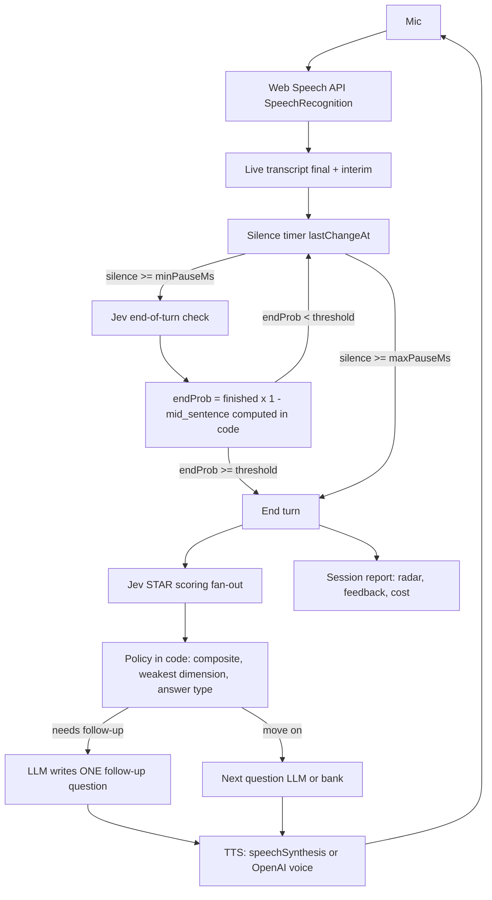

# Voice Interview Coach

A browser voice app that runs mock job interviews. It speaks a question, listens to your
spoken answer, and uses **Jev** (TypeSafe AI's fast decision model) as a **semantic
end-of-turn detector** on the live transcript — so it doesn't cut you off during an "um…"
pause. After each answer, Jev scores it on a **STAR rubric**, plain code decides whether a
follow-up is needed, and an LLM writes the follow-up question and the final feedback.

**Jev listens and scores, code decides, the LLM talks.**

## Architecture



## Why semantic turn-taking beats a fixed silence timeout

A naive voice bot ends your turn after N seconds of silence. Real speech is full of
meaningful pauses: recalling a detail ("So the situation was… um…"), hesitating before a
number, or thinking mid-sentence. A fixed timeout interrupts all of those.

Jev instead reads the **last ~80 words** of the transcript and answers two tiny questions:
*has the candidate finished?* and *does it end mid-sentence?* The app combines them in code
(`endProb = finished × (1 − mid_sentence)`) and only ends the turn when that probability
crosses your threshold. Every check is ~500 input tokens (~$0.00002) and returns in ~200 ms,
so the loop stays realtime.

## Setup

```bash
# 1. Secrets (server-side only, never shipped to the browser)
supabase secrets set TYPESAFE_API_KEY=... OPENAI_API_KEY=...

# 2. Deploy the edge functions
supabase functions deploy jev interviewer tts

# 3. Run
npm run dev
```

Use **Chrome** — its Web Speech implementation is the most reliable. Firefox has no
`SpeechRecognition`, so the app falls back to a typed-input mode with the same flow.

## Env vars

| Variable | Where | Purpose |
| --- | --- | --- |
| `TYPESAFE_API_KEY` | Edge Function secret | Jev API access (`jev` function) |
| `OPENAI_API_KEY` | Edge Function secret | Interviewer LLM + optional TTS |
| `OPENAI_BASE_URL` | Edge Function secret (optional) | Default `https://api.openai.com/v1` |
| `OPENAI_MODEL` | Edge Function secret (optional) | Default `gpt-6-luna` |
| `OPENAI_TTS_MODEL` | Edge Function secret (optional) | Default `gpt-4o-mini-tts` |
| `OPENAI_TTS_VOICE` | Edge Function secret (optional) | Default `alloy` |
| `DAILY_CALL_LIMIT` | Edge Function secret (optional) | Paid upstream calls per function per UTC day. Default `200`; `0` disables paid calls |
| `VITE_SUPABASE_URL` / `VITE_SUPABASE_ANON_KEY` | Frontend env | Supabase client for persistence |

Without `TYPESAFE_API_KEY` / `OPENAI_API_KEY` the app still runs: turn-taking and scoring
fall back to the heuristic, questions come from the built-in bank, follow-ups and feedback
use templates, and speech uses the browser voice.

## Security notes

- All three functions require a JWT (`verify_jwt = true`); the browser sends the anon key.
- Every paid upstream fetch (Jev, OpenAI chat, OpenAI TTS), retries included, is counted
  first via `increment_usage` (SECURITY DEFINER, executable only by `service_role`). The
  counter fails closed: a counter error returns 503, and over the cap returns 429
  `daily_limit` (the interviewer falls back to its bank/templates instead).
- Request limits: 64 KB bodies (8 KB for `tts`), bounded fields, and at most 20 turns per
  feedback request.
- The browser can only `SELECT` and `INSERT` (size-bounded) on `sessions`, `turns` and
  `turn_checks`. The session's overall score and feedback are saved by the `interviewer`
  function with the service-role key.

## Screens


## Design decisions

- **Tiny transcript window.** Each end-of-turn check sends only the question plus the last
  ~80 words. That keeps input tokens (~500) and latency (~200 ms) flat no matter how long
  the answer gets.
- **The threshold lives in code, not the model.** Jev returns raw probabilities; the
  decision (`endProb ≥ threshold`) is a pure TypeScript function (`decideTurn`), so it is
  unit-testable and tunable live from the drawer without touching the model.
- **Abort-on-speech.** An in-flight check is aborted the moment new words arrive, and stale
  responses are dropped via sequence numbers. A slow check can never end your turn
  incorrectly.
- **Max-silence safety net.** If silence exceeds 4 s (configurable), the turn ends even if
  Jev was unsure — the interview can never hang on a silent candidate.
- **One STAR part per question.** Every rubric dimension is an atomic, literal question
  ("How clearly does the answer state the outcome?"), which is what small decision models
  score reliably. All counting (words, fillers, WPM) and weighting is done in code.
- **Text-only privacy.** Only transcripts and scores are stored — never audio. Note that
  Chrome's speech recognition may process audio on Google's servers; the app itself sends
  only text.
